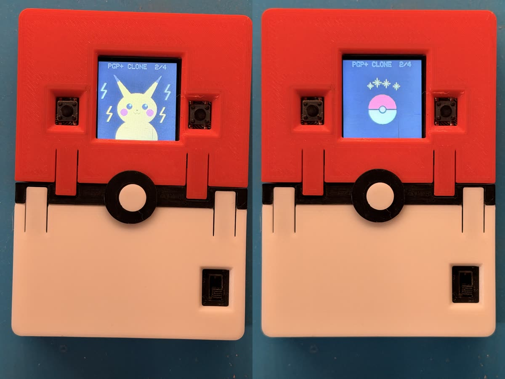
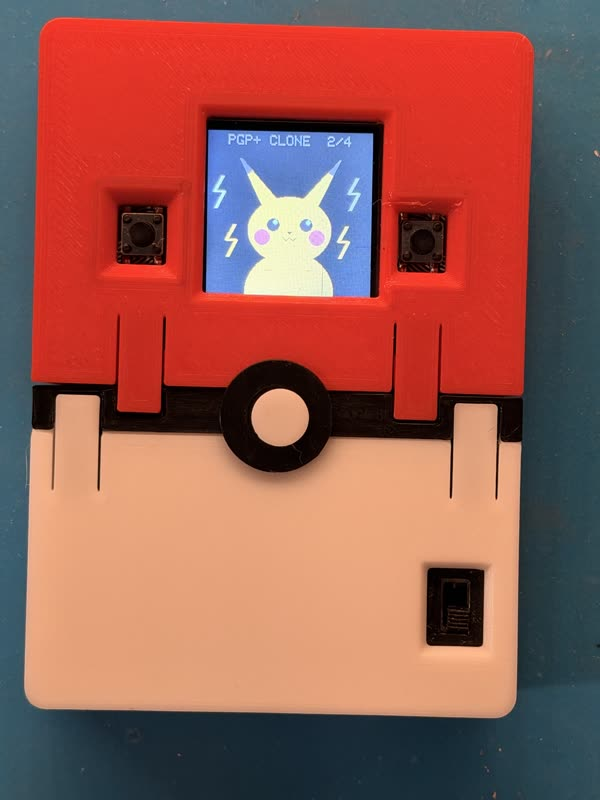
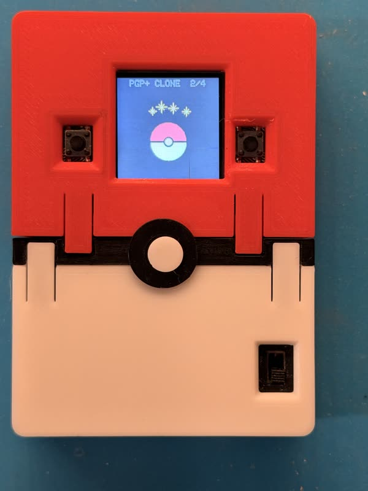
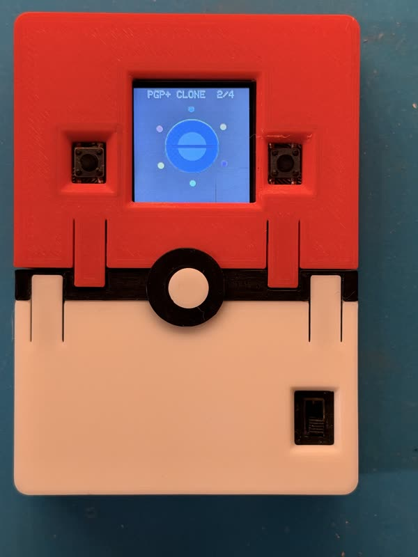
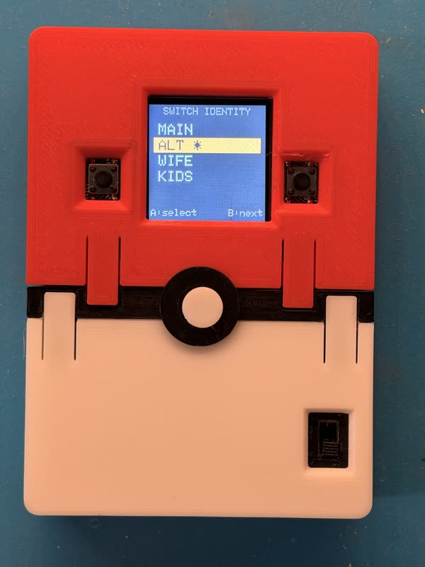
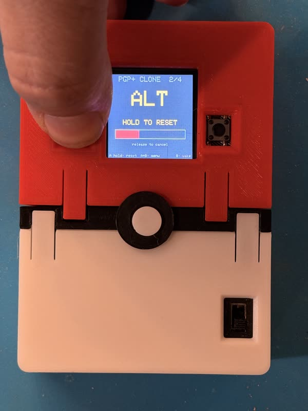
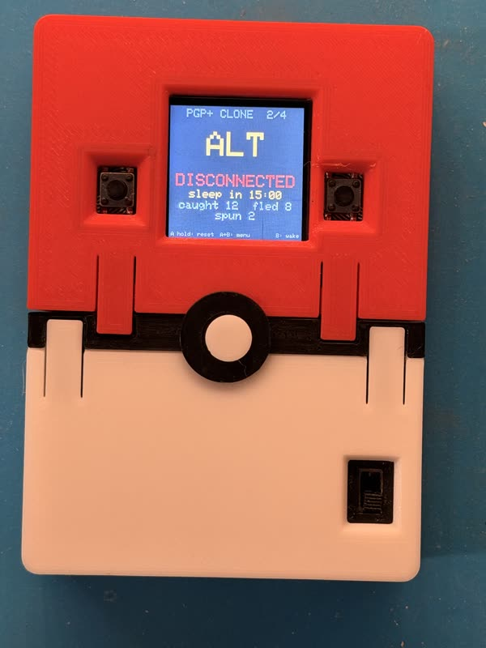
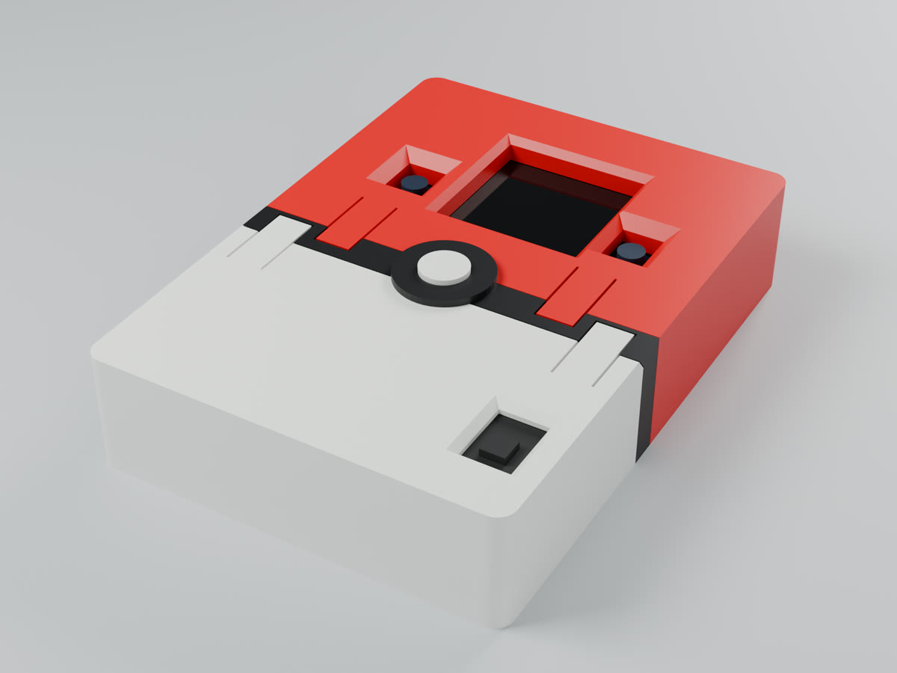

# Pokemon GO Plus + nRF52 Emulator

Experimental nRF52 firmware for emulating a Pokemon GO Plus + BLE peripheral.



This fork adds an [Adafruit CLUE port](#adafruit-clue-port-screen-multi-identity)
with a status screen, animations and more than one identity on a single device,
plus a Seeed XIAO nRF52840 port.

This repository intentionally does not include private device material. To build
the firmware, provide your own `pp_device_material.h` from a device you own.

## What Is Included

- nRF52 Arduino firmware under `code/nrf_emulator/pgpemu_nrf52_plusplus_exp`
- a flash image reader under `tools/flash_image_reader`
- maintainer and protocol notes under `documentation`
- `pp_device_material.template.h` as the public device-material template

## What Is Not Included

- private BLE address / MAC
- cert block or selector/key material from any private device
- raw private flash images
- private app files or unrelated workspaces
- generated Arduino build output

## Device Material Setup

### Reading The External Flash

You need an external flash image from your own Plus+ device.

One working hardware setup is:

- CH341A 24/25-series EEPROM flash USB programmer
- 1.8V adapter for the CH341A
- SOP8/WSON8/QFN8/DFN8 spring-needle probe cable for WSON8 6x5 mm / 6.5 mm chips

The 1.8V adapter is important. Do not read the chip at 3.3V or 5V; higher
voltage can damage the flash chip.

Example probe cable:
https://www.aliexpress.us/item/3256811423345227.html

After reading the chip, save the external flash image file locally. Do not
commit that file to the repository.

### Generating Device Material

1. Put exactly one external flash image file in:

```text
tools/flash_image_reader/input
```

2. Run the reader:

```powershell
cd tools\flash_image_reader
python read_flash_data.py
```

3. Open `pp_device_material.generated.h`.
4. Fill `PP_DEVICE_PUBLIC_ADDR_LE_BYTES` with your device's public BLE address
   in little-endian byte order.
5. Change `PP_DEVICE_MATERIAL_CONFIGURED` to `1`.
6. Place the completed file at:

```text
code/nrf_emulator/pgpemu_nrf52_plusplus_exp/pp_device_material.h
```

The BLE address is not stored in the external flash image. You can read it from
a working device with a normal Bluetooth scanner app or phone Bluetooth device
info.

## Build

Install `arduino-cli`, the Adafruit nRF52 board package, and required Arduino
libraries, then run:

```powershell
arduino-cli compile --fqbn adafruit:nrf52:feather52840 --export-binaries "code\nrf_emulator\pgpemu_nrf52_plusplus_exp"
```

## Adafruit CLUE Port (screen, multi-identity)

`code/nrf_emulator/pgpemu_xiao` is a second sketch that runs on the Adafruit CLUE
(nRF52840, 240x240 screen, two buttons) and on the Seeed XIAO nRF52840. On the
CLUE it adds:

- a status screen: connected / waiting / disconnected, plus caught, fled and
  spun counts for the session
- short animations for boot, catch, PokeStop spin, GO handshake complete, and
  factory reset
- more than one identity in a single build, with an on-screen menu to switch
- a countdown to System OFF after 15 minutes disconnected
- PokeGachi, an optional pet game fed by real spins and catches (off by default)

<table>
  <tr>
    <td></td>
    <td></td>
    <td></td>
  </tr>
  <tr>
    <td align="center">ready</td>
    <td align="center">catch</td>
    <td align="center">spin</td>
  </tr>
  <tr>
    <td></td>
    <td></td>
    <td></td>
  </tr>
  <tr>
    <td align="center">identity menu</td>
    <td align="center">hold A to reset</td>
    <td align="center">disconnected countdown</td>
  </tr>
</table>

The XIAO target has not been rebuilt since the CLUE port landed, so treat it as
untested on the current code. The CLUE build is the one in daily use.

Controls:

| Buttons | Action |
| --- | --- |
| A or B | wake the screen |
| hold A 5 s | factory reset (a bar fills while you hold) |
| hold A+B 1.5 s | settings menu: B = next, A = select |

Settings menu. `Back` is the first row of every list, and B cycles past the
last row to it. The menu closes after 20 s without a press.

| Setting | Values | What it does |
| --- | --- | --- |
| Identity | names in the build | opens the identity list; picking another one switches to it |
| Animations | ON, OFF | OFF skips the catch, spin, ready and boot animations. Catches, spins and the GO handshake then neither light nor extend the screen; warnings such as bag full still do. Meant as a battery saver. |
| Screen sleep | 10s, 30s, 1m, 2m | how long the screen stays lit after a button press (default 30s) |
| PokeGachi | page | opens the PokeGachi page (below); its row shows OFF or ON |

Settings are saved on the device and survive a reboot, an identity switch and
a factory reset. Switching identity clears the pairing and reboots, so pair
again in GO.

Adding a setting is one field in `pp_settings_logic`, one setter in
`pp_settings` and one table entry in `pp_menu_items.cpp`. The menu logic
(`pp_menu_logic`) and the drawing (`pp_menu_draw`) do not change. Host tests
for the logic: `bash tests/run.sh` from WSL.

### PokeGachi

An optional pet game. Spinning a PokeStop earns a berry (up to 10), a catch
brings an opponent to battle (up to 5), and the first catch after turning it on
brings a pet. Feed it, play with it and win battles to fill its three tracks,
then evolve it, and retire its final form to the sanctuary. Nothing decays and
nothing lights a dark screen. Off, the device behaves exactly as without it.
Progress is saved on the device and survives a reboot, an identity switch and
a factory reset; only Reset game clears it.

With PokeGachi on, the home screen is the pet face: identity and link state on
top, the pet's sprite, its name, stage and tracks, the berries and opponents
(the sleep countdown takes that line while it runs), and the last event or the
counters at the bottom. A new pet is announced by a card the next time the
screen is lit.

| Buttons | Action |
| --- | --- |
| B five times in 2 s | open the PokeGachi page (only while PokeGachi is on) |
| in a battle | B = next pick (fire, water, grass), A = throw; first to two round wins |

The PokeGachi page (also the PokeGachi row of the settings menu):

| Row | What it does |
| --- | --- |
| Feed | spends a berry for Nutrition |
| Play | raises Happiness, which can never pass Nutrition or Experience |
| Battle | fights the oldest waiting opponent; a win gives Experience |
| Evolve / Retire | when all three tracks are full |
| Pokedex | the species raised so far |
| Sanctuary | retired pets, newest first |
| Enabled | turns the game on or off; the pet and pantry are kept |
| Reset game | asks first, then starts the game over |

After an action a result card shows for about 2 s, or until a press. A battle
left alone ends with no result when the screen sleeps.

#### The living pet

With PokeGachi on and Animations on, the home screen is a small stage: the
pet lives on a meadow and wanders whenever the screen is lit: it stands, bobs
now and then, and walks to a new spot. Lighting the screen sets it walking.

- Reactions (a dark screen stays dark for these): a catch makes it hop with
  hearts; a flee makes it flop with stars and get up; a spin drops a berry
  beside it (with 10 berries the berry bounces away and the screen says
  `full`); a Pokemon nearby gives a small jump and a `!`.
- Disconnecting lights the screen for about 5 s and shows the pet asleep on a
  night meadow with Zzz. Reconnecting, when GO finishes its handshake, lights a
  dark screen too and the pet wakes with a hop on the day meadow.
- The Feed result card shows the pet eating a berry (for the species that have
  an eating animation; the others idle); the animation plays on the card.
- Play is a chase in one of four random scenes for about 5 s, then the result
  card. The pet runs after a butterfly (meadow), a beach ball (beach), a
  falling leaf (forest) or a firefly (night camp) and jumps for it at the end.
- Evolve flickers the stage between the old and new form, settles on the new
  one, then shows the card.
- Any button press skips a play chase or an evolve flicker and goes to the card.
- With no pet yet, the stage shows an empty ball on the meadow.

What plays when:

| Setting | Catch, spin, ready | Home screen |
| --- | --- | --- |
| PokeGachi off | the device animations (ball closing, coin flip, ready) | the text status screen |
| Animations OFF | no animation; the counters change only | the text status screen, or a still pet with PokeGachi on (no reactions; feed, play and evolve go straight to their cards) |
| PokeGachi on, Animations on | the pet's reactions replace the device animations | the pet stage |

Nothing but connecting, disconnecting and warnings (such as bag full) lights a
dark screen. A catch, flee or spin with the screen dark leaves it dark; the
counters are right when you wake it.

#### Sprites and credits

The pet art is not part of this project or its licence and is never committed.
It comes from PMD SpriteCollab, which is CC BY-NC. You fetch it yourself with
the sprite tool, which downloads the sheets into a local, gitignored cache and
writes the sprite table with its animations:

```powershell
python tools/sprites/gen_sprites.py code/nrf_emulator/pgpemu_xiao/pp_gachi_sprites.generated.h
```

`pp_gachi_sprites.generated.h` and the cache are gitignored. Never commit them.
The artists are credited at https://sprites.pmdcollab.org/. Keep any build that
uses the art non-commercial and keep that credit with it.

`--dummy` builds with no art (no download), writing placeholder sprites:

```powershell
python tools/sprites/gen_sprites.py code/nrf_emulator/pgpemu_xiao/pp_gachi_sprites.generated.h --dummy
```

With no generated file at all the firmware still builds and draws placeholders.

#### Previewing on a PC

The preview tool renders the real drawing code (no board needed) to PNG
stills and animated GIFs of every pet scene and reaction. It uses whatever
sprite table is in the sketch folder (placeholders if none). From WSL, with
the Adafruit GFX library folder and an output folder that git ignores:

```bash
bash tests/preview/render.sh <Adafruit_GFX library dir> build/preview
```

Then, with a Python that has Pillow, turn the frames into images:

```powershell
python -I tests/preview/ppm_to_png.py build/preview
```

This writes a PNG per still, and a GIF plus a sheet of sampled frames per
animated preview. Never commit the output.

### Identity table

This sketch does not read `pp_device_material.h` directly. It builds from a
generated table, `pp_identities.generated.h`, which holds one or more
identities. The table is gitignored. Never commit or share a real one.

To try the screen and menu with no real device material (these fake identities
advertise but can never pair):

```powershell
python tools/identity_table/gen_identities.py code/nrf_emulator/pgpemu_xiao/pp_identities.generated.h --dummy TEST1 TEST2
```

With real material, pass one completed device-material header per identity.
The name is what the screen shows (10 characters max):

```powershell
python tools/identity_table/gen_identities.py code/nrf_emulator/pgpemu_xiao/pp_identities.generated.h MAIN=path/to/pp_device_material.main.h ALT=path/to/pp_device_material.alt.h
```

### Build and flash

Needs the Adafruit nRF52 board package and these libraries: Adafruit GFX,
Adafruit ST7735 and ST7789, Adafruit NeoPixel.

```powershell
arduino-cli compile --fqbn adafruit:nrf52:cluenrf52840 --output-dir build/clue "code/nrf_emulator/pgpemu_xiao"
```

Convert the hex to UF2 with `uf2conv.py` from the Adafruit nRF52 core
(`tools/uf2conv` inside the board package):

```powershell
python uf2conv.py build/clue/pgpemu_xiao.ino.hex -c -f 0xADA52840 -o clue.uf2
```

Double-tap the CLUE reset button, then copy `clue.uf2` to the `CLUEBOOT` drive.

### Power and case

The CLUE has no LiPo charger. It runs well from the Adafruit 3xAAA holder
(product 727) on the JST port. A printable pocket case for the CLUE and that
holder is here:

https://www.printables.com/model/1925937-poke-ball-pocket-case-for-adafruit-clue-3xaaa-pack



Three single-color parts, no screws: the two trays slide onto the black chassis
and four snap tongues lock them. The screen and buttons sit below the surface so
a pocket cannot press on them.

## Release Safety

Before publishing your own fork, make sure these are not committed:

- `pp_device_material.h`
- `pp_identities.generated.h`
- `tools/flash_image_reader/input/`
- `tools/flash_image_reader/device_material_info.txt`
- `tools/flash_image_reader/pp_device_material.generated.h`
- `code/nrf_emulator/pgpemu_nrf52_plusplus_exp/build/`

## Status

Current firmware behavior is documented in:

- `documentation/firmware_module_reference.md`
- `documentation/firmware_protocol_map.md`
- `documentation/plusplus_backup_reference.md`
